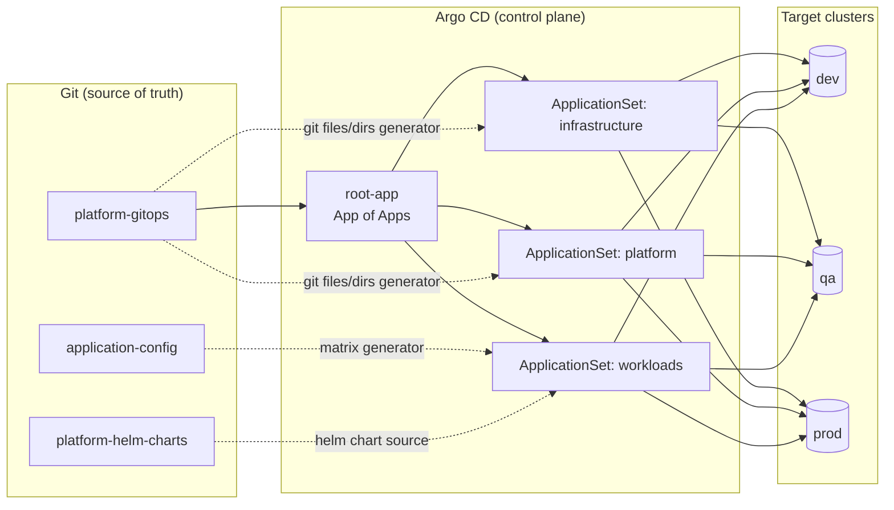
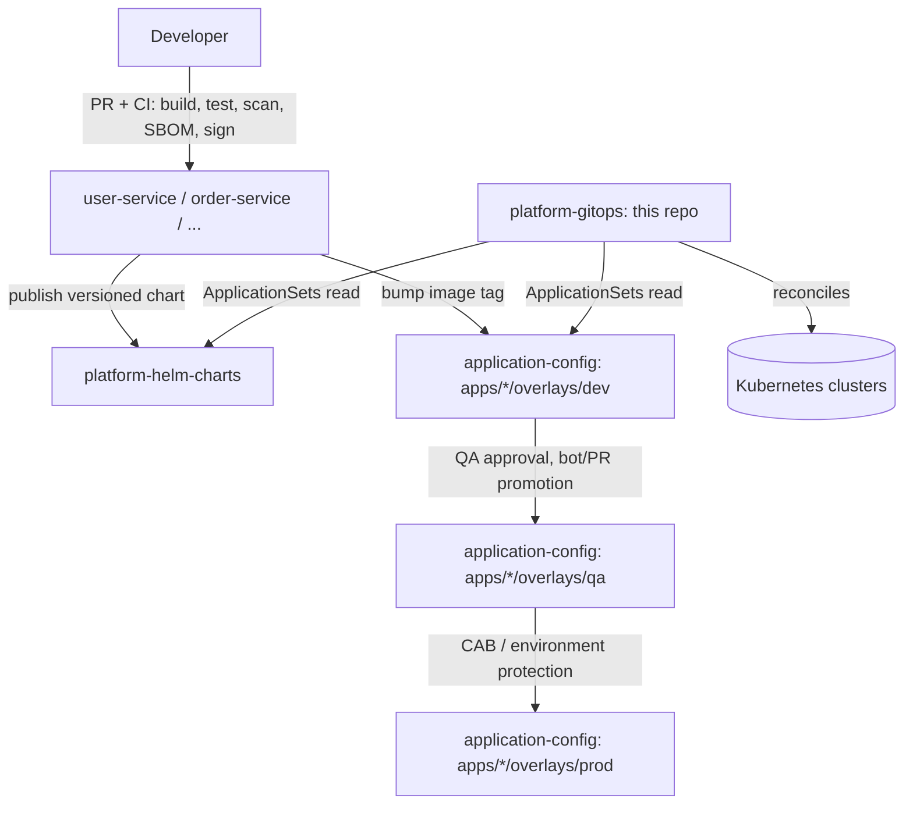

# Architecture Overview

## What this repository is

`platform-gitops` is the single source of truth for **desired cluster
state** across the rhythmx-platform: Argo CD itself, cluster-foundational
infrastructure, platform addons (policy engine, observability), and the
Applications/ApplicationSets that deploy business workloads sourced from
`application-config`. See the root [README.md](../../README.md) for the
three-repo split rationale (this repo / `platform-helm-charts` /
`application-config`).

## High-level GitOps flow

## Repository / responsibility split

## Cluster topology model

Each of `dev`, `qa`, `prod` under `clusters/` represents an **independent
target cluster** in the intended production topology (separate blast
radius, separate upgrade cadence, separate change windows). In the local
Kind bootstrap sandbox (`bootstrap/`), only `dev` maps to a real,
registered cluster (the Kind cluster IS the dev cluster — Argo CD runs
in-cluster there); `qa`/`prod` describe fully valid desired state ahead of
those clusters being provisioned and registered
(`argocd cluster add ...`) — see `clusters/qa/infrastructure/env.yaml` /
`clusters/prod/infrastructure/env.yaml` for the placeholder API server
endpoints and registration instructions.

## Sync-wave ordering (within any one environment)

| Wave | What | Why |
|---|---|---|
| `-1` | Namespaces, PriorityClasses | Must exist before anything schedules into them |
| `0` | `root-app` self-reconciliation | App-of-apps bootstraps itself |
| `1` | Infrastructure Helm charts (ingress-nginx, cert-manager, external-secrets, metrics-server) | CRDs/webhooks must exist before dependent CRs |
| `2` | CRs depending on wave-1 CRDs (`ClusterIssuer`, `ClusterSecretStore`), Kyverno controller chart | Depends on wave-1 completing |
| `3` | Kyverno `ClusterPolicy` objects, workload Applications | Depends on the admission controller (wave 2) being live |

See `argocd.argoproj.io/sync-wave` annotations throughout `app-of-apps/`,
`applications/`, and the `patches:` blocks in every
`clusters/<env>/{infrastructure,platform}/kustomization.yaml`.

## Observability rollout status

Kube-prometheus-stack / Loki / Tempo / OpenTelemetry are **staged, not
live** — see `infrastructure/monitoring/README.md` for the phased rollout
plan and why `applications/platform/monitoring.yaml` ships as a
manual-sync placeholder rather than an automated Application.

## Related documents

- [Repository strategy](repository-strategy.md)
- [Promotion flow](promotion-flow.md)
- [Deployment strategies](deployment-strategies.md)
- [Secrets management](secrets-management.md)
- [Autoscaling](autoscaling.md)
- [Disaster recovery](disaster-recovery.md)
- [Supply chain security](supply-chain-security.md)
- [Naming standards](naming-standards.md)
