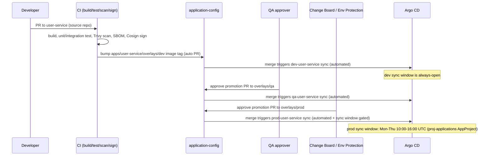

# Promotion Flow

## Two independent promotion tracks

This platform has TWO distinct things that get "promoted" through
dev -> qa -> prod, on different cadences, via different mechanisms:

1. **Application workloads** — promoted via `application-config` overlay
   changes (image tag / config bumps). This repo (`platform-gitops`) does
   not hold that state; see `application-config/promotion/` for the actual
   promotion tooling. This repo only defines the ApplicationSet
   (`app-of-apps/applicationset-workloads.yaml`) that reconciles whatever
   `application-config` currently says per environment.
2. **Platform infrastructure/policy changes** — promoted via THIS repo's
   own `clusters/dev/` -> `clusters/qa/` -> `clusters/prod/` directories,
   using RollingSync ordering baked into the ApplicationSets.

## Track 1: Application workload promotion (application-config)

Nothing in `platform-gitops` changes during this flow — the
ApplicationSet's git matrix generator already watches
`application-config`'s `apps/*/overlays/{dev,qa,prod}` continuously; a
merge there is picked up on Argo CD's next `--enable-helm`-free kustomize
build + diff (default 3-minute poll, or immediately via the
`application-config` repo's webhook if configured).

## Track 2: Platform infrastructure/policy promotion (this repo)

A change to, say, `infrastructure/ingress-nginx/values.yaml` or a new
Kyverno policy follows this repo's own RollingSync:

1. PR merges to `main` touching `clusters/dev/infrastructure/...` (and, if
   the change should also land in qa/prod, the corresponding
   `clusters/qa/...` / `clusters/prod/...` files in the SAME PR — there is
   no separate "promotion PR" step for platform infra; the environment
   directories under `clusters/` ARE the promotion mechanism, gated by
   RollingSync + sync windows, not by separate merges).
2. `app-of-apps/applicationset-infrastructure.yaml`'s `strategy.rollingSync`
   applies the change to `dev-infrastructure` first (`maxUpdate: 100%`).
3. Once dev is healthy, `qa-infrastructure` syncs (`maxUpdate: 100%`).
4. Once qa is healthy, `prod-infrastructure` syncs — but ONLY inside the
   `proj-infrastructure` AppProject's `prod-*` sync window (business hours,
   Mon-Fri 06:00-18:00 UTC) AND with `maxUpdate: "1"` (single-Application
   rolling step, since there's currently only one `prod-infrastructure`
   Application — this becomes meaningful once the platform manages
   multiple prod clusters).

The same pattern applies to `app-of-apps/applicationset-platform.yaml`
(Kyverno + observability).

## Why NOT promote platform changes the same way as app workloads

Platform infra changes (a Helm chart bump, a new NetworkPolicy, a Kyverno
policy going from `Audit` to `Enforce`) are lower-frequency, higher-blast-
radius, and reviewed by Platform Engineering/Security Architecture directly
in the same PR — there's no analogous "build artifact" that needs a
separate promotion record the way an application's Docker image does.
Environment-directory-as-promotion-mechanism (RollingSync) gives the same
dev-first safety property without the ceremony overhead application teams
need for artifact-level promotion.
