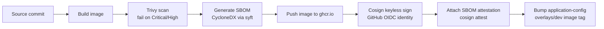

# Supply Chain Security

## Goals

Every container image running org-built code on this platform should be:

1. **Traceable** to the exact source commit and CI run that built it.
2. **Signed** so tampering between build and deploy is detectable.
3. **Scanned** for known vulnerabilities before it's eligible to deploy.
4. **Accompanied by an SBOM** so downstream vulnerability disclosures
   (new CVE in a transitive dependency) can be answered by a query, not an
   archaeology project.

This is implemented as a CI-side pipeline (in each service's source repo,
outside `platform-gitops`) plus an admission-time verification gate
(`policies/image-security/cosign-verify-policy.yaml`, in this repo).

## Pipeline (per-service source repo CI — outside this repo)

- **Trivy** — vulnerability scanning against OS packages + language
  dependencies; the pipeline fails the build on Critical/High findings
  (exceptions require a documented, time-boxed waiver in the source repo,
  not this one).
- **SBOM (CycloneDX via `syft`)** — generated per image, attached as a
  Cosign in-toto attestation (not just an artifact upload) so it's
  cryptographically bound to the specific image digest.
- **Cosign (keyless/Sigstore)** — signs using the GitHub Actions OIDC
  identity as the signing identity (no long-lived signing key to leak or
  rotate); the signature and a transparency log entry are published to
  Rekor (`https://rekor.sigstore.dev`).
- **SLSA** — the pipeline above targets SLSA Build Level 2/3 characteristics
  (build service generates provenance, provenance is authenticated via the
  same GitHub OIDC identity as the image signature). Full SLSA L3
  (hermetic, isolated builds) is a future hardening step, not yet
  guaranteed by every service's CI.

## Admission-time verification (this repo)

`policies/image-security/cosign-verify-policy.yaml` is a Kyverno
`ClusterPolicy` using `verifyImages` to check, for every Pod whose image
matches `ghcr.io/naveenkumar-rhythmx/*`:

1. A valid Cosign signature exists, issued by the expected GitHub Actions
   OIDC subject/issuer.
2. (Currently `Audit`, not yet `Enforce`) a CycloneDX SBOM attestation is
   attached.

Third-party images (ingress-nginx, cert-manager, external-secrets,
metrics-server, kyverno itself) are explicitly OUT of scope for
`verifyImages` — their trust is anchored by pinned chart versions
(`VERSIONS.md`) and the upstream project's own release signing (where
available), not by this platform re-signing third-party images.

## Rollout plan: Audit -> Enforce

1. **Now:** `Audit` mode platform-wide; `PolicyReport`/`ClusterPolicyReport`
   objects surface any unsigned org image without blocking it.
2. **Milestone 1:** every service in `application-config`'s CI pipeline
   produces signed images (tracked outside this repo, per-service).
3. **Milestone 2:** flip `validationFailureAction: Enforce`, scoped first to
   `apps-*-prod` namespaces only (via a namespace-scoped exception on
   dev/qa while they catch up).
4. **Milestone 3:** `Enforce` everywhere, `apps-*-dev`/`apps-*-qa` included.

## What's explicitly out of scope for this repo

- The actual Trivy/syft/Cosign CI steps live in each service's source
  repository, not here.
- Rekor/Fulcio (Sigstore's transparency log / CA) are public infrastructure
  this platform depends on but does not operate.
- Runtime security (falco, seccomp profiles beyond Kyverno's PSA-adjacent
  checks) is a separate, not-yet-adopted control area.
